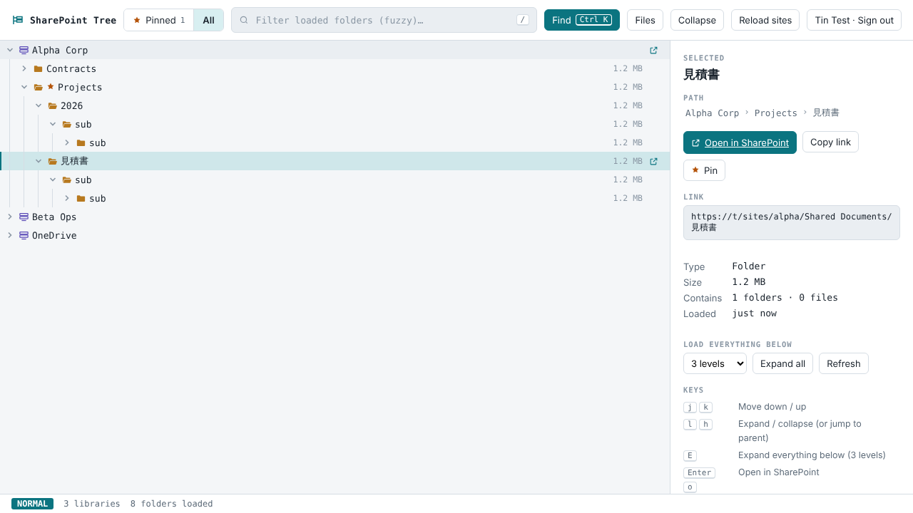

# sptree

A fast, keyboard-driven **tree explorer for SharePoint and OneDrive**.

SharePoint's web UI shows one folder level at a time. sptree shows all your document libraries as one tree you can expand freely, fuzzy-filter, search across every site, and open any folder in SharePoint with one key.



- **One tree, every library.** Every site and document library you can access, plus your OneDrive.
- **Expand everything below a folder.** `E` loads 2, 3, 5 or all levels in the background.
- **Pinned view.** Pin the folders you actually use (`p`) and switch to a view that shows only those (`v`).
- **Fuzzy filter** over loaded folders (`/`) and a **Ctrl K finder** that also searches all of SharePoint.
- **Links.** `Enter` opens the folder or file in SharePoint, `y` copies its link.
- **Vim-style keys**: `j k h l g G`, plus mouse and touch.
- **Read-only.** sptree never changes your files.
- **One binary, no dependencies.** Runs on Windows, macOS and Linux. The web UI is built into the binary.

## How it works

```
browser ──▶ sptree (127.0.0.1:8765) ──▶ Microsoft Graph (as you)
             • serves the built-in UI
             • device-code sign-in, token cached locally
             • /api/libraries, /api/children, /api/search …
```

sptree is a small Go program. It signs you in with the OAuth 2.0 **device-code flow**, keeps the refresh token in your user config directory (mode 0600), and serves the UI on loopback only. The browser never sees your token. Folder listings are cached in the browser's localStorage so the tree reopens instantly.

## Install

Download a binary from [Releases](../../releases), or build it yourself (Go 1.22+):

```sh
go install github.com/TinHLQNguyen/sptree@latest
# or
git clone https://github.com/TinHLQNguyen/sptree && cd sptree && go build
```

## Set up sign-in (one time)

sptree needs an app registration in your organization's Microsoft Entra ID (Azure AD). One registration can be shared by everyone in your organization. If you're not an admin, send these steps to your IT team.

1. Go to **Entra admin center → App registrations → New registration**.
   - Name: `sptree`
   - Supported account types: *Accounts in this organizational directory only* (or multitenant if you'll share it across tenants)
   - Redirect URI: leave empty
2. In **Authentication**, set **Allow public client flows** to **Yes**. Device-code sign-in needs this.
3. In **API permissions → Add a permission → Microsoft Graph → Delegated**, add:
   - `Files.Read.All`
   - `Sites.Read.All`
   - `User.Read`
   - `offline_access`

   If your tenant doesn't allow users to consent to apps, click **Grant admin consent**.
4. From **Overview**, copy the **Application (client) ID** and the **Directory (tenant) ID**.

No client secret is needed. sptree is a public client and only gets delegated permissions, so each person sees only what they can already open in SharePoint.

## Run

```sh
sptree -client-id <application-id> -tenant <tenant-id-or-domain>
```

or put the IDs in a `.env` file (git-ignored) in the directory you run sptree from:

```sh
cp .env.example .env   # then set SPTREE_CLIENT_ID and SPTREE_TENANT
sptree
```

Any of the environment variables below can go in `.env`. Variables already set in your shell take precedence, and flags override both.

Your browser opens at `http://127.0.0.1:8765/`. The first time, it shows a code: open `https://microsoft.com/devicelogin`, enter the code, and sign in. The code is also printed in the terminal, so sign-in works over SSH too. After that, sptree reuses the saved sign-in.

| Flag | Env | Default | |
| --- | --- | --- | --- |
| `-client-id` | `SPTREE_CLIENT_ID` | — | Entra application (client) ID |
| `-tenant` | `SPTREE_TENANT` | `organizations` | Tenant ID or domain |
| `-addr` | `SPTREE_ADDR` | `127.0.0.1:8765` | Listen address (loopback only) |
| `-no-browser` | | `false` | Don't open the browser |
| | `SPTREE_TOKEN_CACHE` | `<config dir>/sptree/token.json` | Where the sign-in is saved |
| | `SPTREE_GRAPH_URL` | `https://graph.microsoft.com/v1.0` | Graph endpoint (sovereign clouds) |
| | `SPTREE_LOGIN_URL` | `https://login.microsoftonline.com` | Entra endpoint (sovereign clouds) |

`sptree logout` deletes the saved sign-in. The **Sign out** button in the UI also clears the browser cache.

## Keys

| Key | Action |
| --- | --- |
| `j` / `k`, `↓` / `↑` | Move down / up |
| `l` / `h`, `→` / `←` | Expand / collapse (or jump to parent) |
| `g` / `G` | First / last row |
| `Space` | Toggle folder |
| `E` | Expand everything below (3 levels) |
| `Enter` / `o` | Open in SharePoint |
| `y` | Copy link |
| `p` | Pin / unpin |
| `v` | Switch Pinned / All view |
| `r` | Refresh folder |
| `/` | Filter loaded folders |
| `Ctrl K` | Find anywhere (`Enter` show in tree, `Shift Enter` open, `Alt Enter` pin) |

## Security and privacy

- Listens on **loopback only**. It refuses non-loopback `-addr`, rejects requests whose `Host` isn't loopback (DNS-rebinding defence), and requires a custom header on POST requests (CSRF defence).
- Uses **read-only delegated** Graph permissions. sptree can't see anything you can't already open.
- The refresh token is stored **unencrypted** in a file only your user can read (0600). Treat it like a browser session cookie. `sptree logout` removes it.
- No telemetry. The only network calls go to Microsoft (and Google Fonts for the UI typeface; without it the UI falls back to system fonts).

## Limitations

- The library list comes from Graph `GET /sites?search=*`. In very large tenants this takes a moment the first time, and it's cached for 30 minutes (**Reload sites** forces a refresh).
- SharePoint-wide search uses the Microsoft Search index. Newly created folders can take a few minutes to show up there. Browsing the tree is always live.
- Pins and the folder cache are stored per browser.

## Development

```sh
go test ./...        # API tests run against a fake Graph/Entra server
go run . -client-id <id>
```

The UI is a single file, `web/index.html` (vanilla JS, no build step), embedded with `go:embed`.

## License

[MIT](LICENSE)
